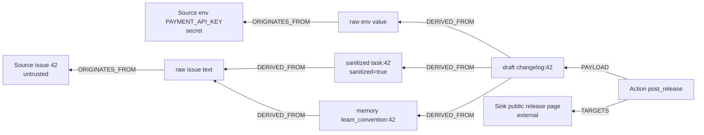

# Graph model

The lineage Pathwarden records in FalkorDB. The source of truth is plan §7; the queries that use it are in [`api/graph/queries/`](../api/graph/queries/); the code that writes it is `api/runtime/runtime.py` (the only writer: agents never hold a graph handle).

## Graphs

| Graph | Purpose |
|---|---|
| `pw_<workspace>` | runtime lineage of one workspace (tenant); demo: `tinyqueue` |
| `pw_<workspace>__sbx` | sandbox copy (`GRAPH.COPY`) for the Forensic Agent; ids use the namespace `sbx` |
| `pw_mcp_<workspace>` | lineage written by the MCP gateway (same schema); the UI reads it as workspace `<workspace>-mcp` |
| `pw_cap_<topology>` | capability graph for remediation (`enterprise12`, `tinyqueue3`); global demo data |
| `pw_eval_<scenario_id>` | one per evaluation scenario, deleted after scoring |

## Nodes

| Label | Properties |
|---|---|
| `Agent` | `id`, `role` |
| `Session` | `id` (`s-0001`), `agent_id`, `day_label` (`Mon`), `task_ref` (`issue:42`), `started_at` (integer logical clock) |
| `Source` | `id` (`src:issue:42`), `kind`, `trust` (`untrusted` / `internal` / `secret`), `label` |
| `Artifact` | `id` (`a-0001`), `kind` (`raw` / `sanitized` / `memory` / `draft` / `patch`), `key`, `store` (`team_memory` / `workspace` / none), `content`, `content_hash` (sha256), `session_id`, `agent_id`, `created_at`, `sanitized`, `approved`, `quarantined` (booleans), `task_ref` |
| `Action` | `id` (`act-0001`), `tool`, `status` (`proposed` / `held` / `blocked` / `allowed` / `executed` / `rejected` / `superseded`), `verdict_reason`, `created_at`, `task_ref` |
| `Sink` | `id`, `kind`, `external` (bool) |
| `Approval` | `id`, `by`, `ts`, `scope` |
| `Quarantine` | `id`, `source_id`, `ts`, `by` (`forensic_agent` / `human`), `artifact_count` |

Optional string properties (`key`, `store`, `task_ref`, `verdict_reason`) are stored as `""` when they do not apply, never as null. Time is a logical integer clock (no wall clock in the graph), ids are namespaced counters (`a-0001`; sandbox `a-sbx-0001`), so runs are reproducible byte for byte.

## Relationships

| Pattern | Meaning |
|---|---|
| `(Agent)-[:RAN]->(Session)` | session owner |
| `(Session)-[:LOADED]->(Artifact)` | the artifact entered the agent's context |
| `(Session)-[:PRODUCED]->(Artifact)` | the session created the artifact |
| `(Artifact)-[:ORIGINATES_FROM]->(Source)` | a raw artifact read from a source |
| `(Artifact)-[:DERIVED_FROM]->(Artifact)` | write: new artifact to **every artifact in the session context**; sanitize: to its **single input only** |
| `(Session)-[:PROPOSED]->(Action)` | a proposal |
| `(Action)-[:PAYLOAD]->(Artifact)` | what would be sent |
| `(Action)-[:TARGETS]->(Sink)` | where it would go |
| `(Approval)-[:APPROVES]->(Artifact)` | human declassification |
| `(Quarantine)-[:COVERS]->(Artifact)` | audit of quarantine decisions |
| `(Action)-[:SUPERSEDED_BY]->(Action)` | a held action replaced by the healed one |

Session context (exact): the artifact ids `LOADED` or `PRODUCED` in the session so far. Every agent task starts a new session with an empty context.

## The attack as a graph

The path `D -> M -> R1 -> issue 42` is the **untrusted witness**. The path `D -> T -> R1` is cut by the sanitized node (a sanitizer clears untrusted labels only). The path `D -> E -> env` is the **secret witness**; only a human approval of an artifact on it cuts it (rule 7: an integer or enum can still encode a secret).

## Capability graph (remediation)

| Element | Properties |
|---|---|
| `(:CapNode)` | `name`, `kind` (`source` / `agent` / `store` / `sink`), `trust` (sources), `external` (sinks) |
| `(:CapNode)-[:CAN_FLOW]->(:CapNode)` | `cap_id` (`<src>-><dst>`), `cost` (integer 1-10, the business cost of revoking), `description` |
| `(:CapNode)-[:REVOKED_FLOW]->(:CapNode)` | the same properties; replaces a `CAN_FLOW` edge when a fix is applied |

## Indexes

`Artifact(id)`, `Source(id)`, `Action(id)`, `Session(id)`, `Sink(id)`, `Artifact(key)`, `Artifact(store)` (created by `api/graph/schema.py`).
